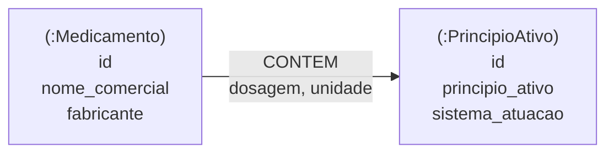

# 💊 API de Medicamentos com Neo4j

API REST desenvolvida com **Java e Spring Boot** para consultar medicamentos e seus **princípios ativos**, usando o banco de dados orientado a grafos **Neo4j**.

Em um grafo, a relação entre as entidades é parte do dado: cada medicamento é conectado aos princípios ativos que contém, com a dosagem guardada na própria relação. Isso permite responder perguntas como "quais medicamentos têm o mesmo princípio ativo?" ou "quais têm exatamente a mesma composição que este?" com consultas simples em Cypher.

> Projeto acadêmico de estudo de bancos de dados NoSQL orientados a grafos.
> **Status:** em desenvolvimento. Veja a seção [Estado atual do projeto](#-estado-atual-do-projeto).

## 🚀 Funcionalidades

- Cadastro, listagem, busca, atualização e remoção de medicamentos, com sua composição (princípio ativo, dosagem e unidade)
- Busca de medicamento por ID ou por nome comercial
- Busca de **todos os medicamentos que contêm um determinado princípio ativo**
- Busca de **medicamentos com a mesma composição** que um medicamento de referência (útil para encontrar alternativas)
- Listagem, busca, atualização e remoção de princípios ativos
- Tratamento de erros com resposta `404` para medicamento ou princípio ativo inexistente

## 🕸️ Modelo de grafo



| Elemento | Tipo | Propriedades |
|---|---|---|
| `Medicamento` | Nó | `id` (UUID), `nome_comercial`, `fabricante` |
| `PrincipioAtivo` | Nó | `id` (UUID), `principio_ativo`, `sistema_atuacao` |
| `CONTEM` | Relação `(Medicamento)→(PrincipioAtivo)` | `dosagem`, `unidade` |

Um medicamento pode conter vários princípios ativos, e um princípio ativo pode estar em vários medicamentos.

## 🛠️ Tecnologias Utilizadas

- Java 21
- Spring Boot 4.0.0
- Spring Web MVC
- Spring Data Neo4j
- Neo4j (banco de dados de grafos) e Cypher
- Lombok
- Maven (com Maven Wrapper)

## 🧱 Estrutura do projeto

```
src/main/java/ifpb/api_medicamentos_neo4j
├── controller   # Endpoints REST
├── service      # Regras de negócio
├── repository   # Acesso ao Neo4j (derived queries e consultas Cypher)
├── entity       # Nós (Medicamento, PrincipioAtivo) e relação (Contem)
├── DTO          # Objetos de requisição e resposta
├── mapper       # Conversão entre entidades e DTOs
└── exception    # Exceções de domínio e handler global
```

## ⚙️ Como executar

### Pré-requisitos

- JDK 21
- Docker (para subir o Neo4j) ou uma instância local do Neo4j
- Git

### 1. Clone o repositório

```bash
git clone https://github.com/mthbrito/API_Medicamentos_Neo4j.git
cd API_Medicamentos_Neo4j
```

### 2. Suba o Neo4j

```bash
docker run --name neo4j \
  -p 7474:7474 -p 7687:7687 \
  -e NEO4J_AUTH=neo4j/neo4j_teste \
  -d neo4j:5
```

O Neo4j Browser ficará disponível em `http://localhost:7474`. O usuário e a senha acima correspondem aos valores configurados no `application.properties`.

### 3. Carregue os dados de exemplo

Ainda não existe endpoint para cadastrar princípios ativos, e o cadastro de medicamentos espera que os princípios informados já existam no banco. Por isso, carregue alguns dados iniciais executando o script abaixo no Neo4j Browser (ou via `cypher-shell`).

> Os dados são **fictícios e ilustrativos**, apenas para testar a API. Não devem ser usados como referência médica.

```cypher
CREATE
  (paracetamol:PrincipioAtivo {id: randomUUID(), principio_ativo: 'Paracetamol',  sistema_atuacao: 'Sistema nervoso central'}),
  (dipirona:PrincipioAtivo    {id: randomUUID(), principio_ativo: 'Dipirona',     sistema_atuacao: 'Sistema nervoso central'}),
  (orfenadrina:PrincipioAtivo {id: randomUUID(), principio_ativo: 'Orfenadrina',  sistema_atuacao: 'Sistema musculoesquelético'}),
  (cafeina:PrincipioAtivo     {id: randomUUID(), principio_ativo: 'Cafeína',      sistema_atuacao: 'Sistema nervoso central'}),

  (m1:Medicamento {id: randomUUID(), nome_comercial: 'Analgex 750',        fabricante: 'Laboratório Exemplo'}),
  (m2:Medicamento {id: randomUUID(), nome_comercial: 'Paracetamol 750 Genérico', fabricante: 'Laboratório Modelo'}),
  (m3:Medicamento {id: randomUUID(), nome_comercial: 'Relaxan Plus',       fabricante: 'Laboratório Exemplo'}),
  (m4:Medicamento {id: randomUUID(), nome_comercial: 'Musculex Composto',  fabricante: 'Laboratório Modelo'}),
  (m5:Medicamento {id: randomUUID(), nome_comercial: 'Dorzin 500',         fabricante: 'Laboratório Exemplo'}),

  (m1)-[:CONTEM {dosagem: '750', unidade: 'mg'}]->(paracetamol),
  (m2)-[:CONTEM {dosagem: '750', unidade: 'mg'}]->(paracetamol),

  (m3)-[:CONTEM {dosagem: '300', unidade: 'mg'}]->(dipirona),
  (m3)-[:CONTEM {dosagem: '35',  unidade: 'mg'}]->(orfenadrina),
  (m3)-[:CONTEM {dosagem: '50',  unidade: 'mg'}]->(cafeina),

  (m4)-[:CONTEM {dosagem: '300', unidade: 'mg'}]->(dipirona),
  (m4)-[:CONTEM {dosagem: '35',  unidade: 'mg'}]->(orfenadrina),
  (m4)-[:CONTEM {dosagem: '50',  unidade: 'mg'}]->(cafeina),

  (m5)-[:CONTEM {dosagem: '500', unidade: 'mg'}]->(dipirona);
```

Opcionalmente, crie restrições de unicidade para os identificadores e nomes:

```cypher
CREATE CONSTRAINT medicamento_id IF NOT EXISTS
  FOR (m:Medicamento) REQUIRE m.id IS UNIQUE;

CREATE CONSTRAINT principio_ativo_id IF NOT EXISTS
  FOR (p:PrincipioAtivo) REQUIRE p.id IS UNIQUE;

CREATE CONSTRAINT principio_ativo_nome IF NOT EXISTS
  FOR (p:PrincipioAtivo) REQUIRE p.principio_ativo IS UNIQUE;
```

### 4. Execute a aplicação

```bash
./mvnw spring-boot:run
```

A API ficará disponível em `http://localhost:8080`.

### Configuração

Arquivo `src/main/resources/application.properties`:

```properties
spring.neo4j.uri=neo4j://127.0.0.1:7687
spring.neo4j.authentication.username=neo4j
spring.neo4j.authentication.password=neo4j_teste
spring.data.neo4j.database=neo4j
```

> Essas são credenciais de teste para ambiente local. Em qualquer outro ambiente, use variáveis de ambiente e senhas próprias.

## 🔗 Endpoints

### Medicamentos — `/api/medicamentos`

| Método | Endpoint | Descrição |
|---|---|---|
| `POST` | `/api/medicamentos` | Cadastra um medicamento com sua composição |
| `GET` | `/api/medicamentos` | Lista todos os medicamentos |
| `GET` | `/api/medicamentos/{id}` | Busca um medicamento pelo **ID** |
| `GET` | `/api/medicamentos/medicamento/{nome}` | Busca um medicamento pelo **nome comercial**, com a composição |
| `GET` | `/api/medicamentos/principio-ativo/{principioAtivo}` | Lista os medicamentos que contêm o princípio ativo |
| `GET` | `/api/medicamentos/medicamento/{medicamento}/mesma-composicao` | Lista os medicamentos com a mesma composição do medicamento informado |
| `PUT` | `/api/medicamentos/{id}` | Atualiza nome, fabricante e/ou composição |
| `DELETE` | `/api/medicamentos/{id}` | Remove um medicamento |

### Princípios ativos — `/api/principios-ativos`

| Método | Endpoint | Descrição |
|---|---|---|
| `GET` | `/api/principios-ativos` | Lista todos os princípios ativos |
| `GET` | `/api/principios-ativos/{id}` | Busca um princípio ativo pelo **ID** |
| `GET` | `/api/principios-ativos/principio-ativo/{nome}` | Busca um princípio ativo pelo **nome** |
| `PUT` | `/api/principios-ativos/{id}` | Atualiza nome e/ou sistema de atuação |
| `DELETE` | `/api/principios-ativos/{id}` | Remove um princípio ativo |

## 📨 Exemplos de uso

**Buscar medicamentos por princípio ativo**

```bash
curl http://localhost:8080/api/medicamentos/principio-ativo/Paracetamol
```

```json
[
  { "id": "3f1c9a2e-...", "nome": "Analgex 750", "fabricante": "Laboratório Exemplo" },
  { "id": "8b7d4e10-...", "nome": "Paracetamol 750 Genérico", "fabricante": "Laboratório Modelo" }
]
```

**Buscar medicamento com a composição**

```bash
curl "http://localhost:8080/api/medicamentos/medicamento/Relaxan%20Plus"
```

```json
{
  "nome": "Relaxan Plus",
  "fabricante": "Laboratório Exemplo",
  "composicao": [
    { "principioAtivo": "Dipirona",    "dosagem": "300", "unidade": "mg" },
    { "principioAtivo": "Orfenadrina", "dosagem": "35",  "unidade": "mg" },
    { "principioAtivo": "Cafeína",     "dosagem": "50",  "unidade": "mg" }
  ]
}
```

**Encontrar medicamentos com a mesma composição**

```bash
curl "http://localhost:8080/api/medicamentos/medicamento/Relaxan%20Plus/mesma-composicao"
```

```json
{
  "medicamentoComComposicaoResponseDTO": {
    "nome": "Relaxan Plus",
    "fabricante": "Laboratório Exemplo",
    "composicao": [ ... ]
  },
  "principiosAtivos": [
    { "id": "c52a7f91-...", "nome": "Musculex Composto", "fabricante": "Laboratório Modelo" }
  ]
}
```

> O campo `principiosAtivos` dessa resposta contém, na verdade, a lista de **medicamentos** equivalentes (veja as pendências).

**Cadastrar um medicamento** (os princípios ativos precisam já existir)

```bash
curl -X POST http://localhost:8080/api/medicamentos \
  -H "Content-Type: application/json" \
  -d '{
    "nome": "Analgex Gotas",
    "fabricante": "Laboratório Exemplo",
    "composicao": [
      { "principioAtivo": "Dipirona", "dosagem": "500", "unidade": "mg/mL" }
    ]
  }'
```

## 🔍 Consultas Cypher do projeto

As duas consultas que mais mostram o valor do grafo, usadas nos repositórios:

**Medicamentos que contêm um princípio ativo**

```cypher
MATCH (m:Medicamento)-[:CONTEM]->(p:PrincipioAtivo)
WHERE p.principio_ativo = $principioAtivo
RETURN m;
```

**Medicamentos com a mesma composição de um medicamento de referência**

```cypher
MATCH (mRef:Medicamento {nome_comercial: $medicamento})-[:CONTEM]->(pRef:PrincipioAtivo)
WITH mRef, pRef.principio_ativo AS principio
ORDER BY principio
WITH mRef, collect(principio) AS compRef
MATCH (m:Medicamento)-[:CONTEM]->(p:PrincipioAtivo)
WITH mRef, compRef, m, p.principio_ativo AS principio
ORDER BY principio
WITH mRef, compRef, m, collect(principio) AS compM
WHERE compRef = compM AND m <> mRef
RETURN m;
```

A segunda consulta monta, para cada medicamento, a lista ordenada de seus princípios ativos e compara com a lista do medicamento de referência.

## 🚧 Estado atual do projeto

O projeto está em desenvolvimento. Pendências conhecidas:

- **Cadastro de princípios ativos:** não há endpoint para criá-los, e `POST`/`PUT` de medicamentos esperam que os princípios informados já existam. Hoje eles precisam ser carregados direto no Neo4j (veja o script de exemplo).
- **Validação:** os dados de entrada não são validados. Um cadastro sem `composicao`, por exemplo, resulta em erro `500`.
- **Unicidade:** o nome comercial do medicamento não é único, e as buscas por nome assumem um único resultado.
- **"Mesma composição":** a comparação considera apenas **quais** princípios ativos o medicamento contém, não a dosagem.
- **Nomenclatura:** na resposta de `mesma-composicao`, os campos `medicamentoComComposicaoResponseDTO` e `principiosAtivos` têm nomes que não refletem o conteúdo.
- **Mensagens de erro:** as respostas `404` não trazem mensagem no corpo quando a exceção é criada sem texto.
- **Credenciais:** a senha do Neo4j está fixa no `application.properties`.
- **Testes:** existe apenas o teste de carregamento de contexto, que exige um Neo4j em execução.

## 📌 Próximos passos

- Criar o endpoint de cadastro de princípios ativos (ou criá-los automaticamente ao cadastrar o medicamento)
- Adicionar validação com Bean Validation e um handler global mais completo
- Criar restrições de unicidade no banco e tratar duplicidades
- Considerar a dosagem na comparação de composições, ou oferecer as duas variantes
- Mover credenciais para variáveis de ambiente
- Criar `docker-compose.yml` com o Neo4j e o script de carga inicial
- Escrever testes de integração (por exemplo, com Testcontainers)
